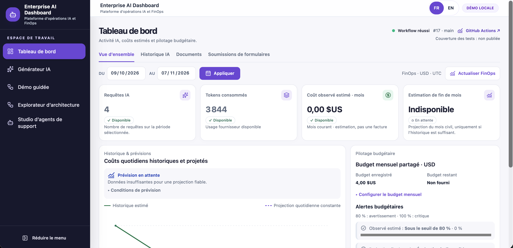
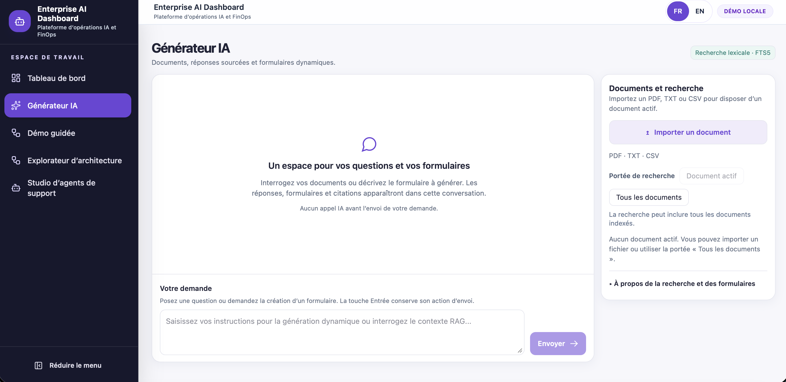
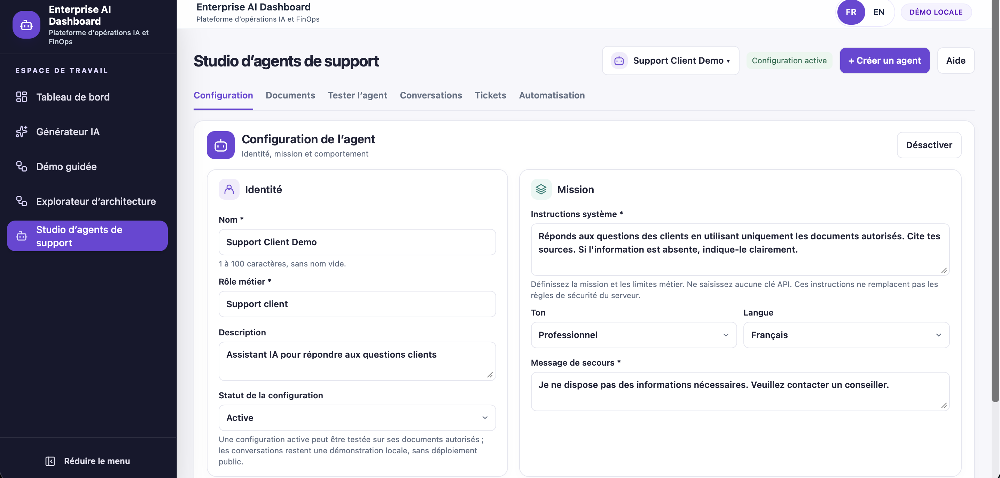

# Enterprise AI Dashboard & Support Agent Studio

**Interfaces Angular, IA documentaire et parcours de support locaux.**

Conçu et développé par **Rabiaa NOUIRA**.

[English](README.md) · Français

[Découvrir la vitrine](https://angular-ai-dashboard.pages.dev) · [Galerie des interfaces](https://angular-ai-dashboard.pages.dev/features) · [Démo guidée](https://angular-ai-dashboard.pages.dev/guided-demo) · [Explorateur d’architecture](https://angular-ai-dashboard.pages.dev/architecture)

> La vitrine publique est une présentation statique interactive avec de vraies captures de l’application locale. Elle n’exécute aucune inférence IA et ne donne accès ni au backend opérationnel ni aux données locales.

## Ce que le projet démontre

Ce projet de portfolio réunit recherche documentaire, interfaces assistées par IA, opérations de support client et suivi des coûts IA estimés dans une application bilingue. L’application métier fonctionne localement ; la vitrine permet d’en découvrir les capacités sans exécuter d’action métier.

| Capacité | Fonctionnement implémenté |
| --- | --- |
| Générateur IA | Import PDF/TXT/CSV, questions sur un périmètre documentaire, sources consultables, détails d’exécution et formulaires générés avec soumission explicite. |
| Support Agent Studio | Configuration des agents, documents autorisés, test indépendant et conversations persistantes à contexte borné. |
| Gestion des tickets | Création confirmée, classification déterministe, recherche, filtres, contrôle de version des modifications et piste d’audit. |
| Transfert à un opérateur | Demandes locales, affectations déclarées, notes et résolution, indépendamment du statut du ticket. |
| Automatisation des workflows | Reçus d’événements durables, préparation explicite des exécutions, reprise manuelle et simulateur local. |
| Dashboard FinOps | Consommation enregistrée, coûts estimés, couverture tarifaire, prévisions conditionnelles, budget partagé enregistré et simulation de scénarios. |
| Découverte du produit | Démo guidée et explorateur d’architecture interactifs ; interfaces français/anglais. |

## Captures réelles de l’application

Ces captures proviennent de l’application locale avec du contenu de démonstration. Ce ne sont pas des maquettes générées. Elles montrent un état précis, pas des métriques en direct ni une preuve de déploiement en production. Cliquer sur une image permet de l’afficher en grand.

### Dashboard FinOps

[](client/showcase-assets/screenshots/dashboard-overview.png)

La consommation et les coûts estimés restent distincts de la facturation. Cette capture montre une prévision indisponible, faute d’historique suffisant.

### Générateur IA

[](client/showcase-assets/screenshots/ai-generator.png)

L’état vide présente le parcours documentaire avant tout envoi explicite d’une demande IA.

### Support Agent Studio

[](client/showcase-assets/screenshots/studio-configuration.png)

Configuration d’un agent de démonstration. Une configuration active n’est pas un agent déployé publiquement.

## Architecture

| Couche | Technologie et rôle |
| --- | --- |
| Interface | Angular 19 standalone, Signals, Reactive Forms, SCSS/Tailwind CSS v4 et Transloco. |
| Backend | BFF Node.js / Express : validations, traitement documentaire et appels Groq explicites. |
| Persistance | SQLite avec migrations additives, conversations, tickets, transferts et audit des workflows. |
| Recherche documentaire | Recherche lexicale SQLite FTS5 et classement BM25 sur les segments de texte extraits. |
| Fournisseur IA | Groq, appelé par le backend à la suite d’actions utilisateur explicites. |
| Présentation publique | Build Angular showcase distinct, routes informatives et absence de client API métier opérationnel. |

Flux documentaire : **PDF/TXT/CSV → texte extrait → segments → recherche FTS5/BM25 → contexte → appel Groq explicite → réponse et références**.

Les politiques diffèrent : le Générateur peut répondre sans appui documentaire lorsqu’aucun passage pertinent n’est retrouvé ; le Studio applique une abstention plus stricte sur les documents autorisés. Les citations identifient des passages, sans garantir l’exactitude factuelle d’une réponse.

## Compétences freelance illustrées

- Création et modernisation d’interfaces métier Angular, responsive et bilingues.
- Intégration d’IA documentaire avec appels API côté serveur et sources consultables.
- Développement de parcours de support persistants, confirmations, contrôles de concurrence et pistes d’audit.
- Réalisation de dashboards de consommation, estimations de coûts et contrôles automatisés de non-régression.

Il s’agit de capacités démontrées par ce projet, sans revendication de mission client, de résultat commercial ou de certification de production.

## Exécution locale

Utiliser Node.js 24 pour correspondre à la CI du dépôt. Depuis la racine :

```bash
npm ci
(cd client && npm ci --legacy-peer-deps)
(cd server && npm ci)
```

Pour la vitrine statique seule, aucun backend ni clé Groq n’est nécessaire :

```bash
cd client
npm run start:showcase
```

Ouvrir <http://127.0.0.1:4300/>. Les routes de présentation sont `/`, `/features`, `/guided-demo` et `/architecture`.

Pour l’application métier, créer un fichier local non suivi `server/.env` :

```dotenv
GROQ_API_KEY=<votre-cle-locale>
DASHBOARD_TELEMETRY_LOCAL_ONLY=true
HOST=127.0.0.1
PORT=3000
```

Lancer `npm start` depuis `server` et depuis `client`, dans deux terminaux. Ouvrir <http://localhost:4200/dashboard>. Le démarrage du backend crée/ouvre la base SQLite locale et applique automatiquement les migrations en attente ; sauvegarder une base existante avant de lancer une version mise à jour.

Configurer `GROQ_MODEL_PRICING` avec des tarifs de modèles vérifiés, selon la [configuration FinOps](docs/FINOPS.md#configuration). Un tarif absent reste indisponible ; il n’est pas remplacé par zéro.

## Validation

```bash
(cd client && npm run check:i18n)
(cd client && npm test -- --runInBand)
(cd client && npm run build)
(cd client && npm run build:showcase)
(cd server && npm test)
git diff --check
```

Dernière vérification locale du frontend, le 8 novembre 2026 : **256 tests dans 30 suites**, **1 269 clés de traduction correspondantes**, builds métier et vitrine de production réussis. La suite complète a réussi sous Node 24.20.0 avec cache désactivé et mémoire limitée à 4 Go, après un précédent crash natif V8. Ces résultats locaux ne constituent ni une certification de production ni une validation exhaustive du responsive ou de l’accessibilité. Aucun test n’a été relancé pour préparer ces README.

## Périmètre et limites

- Application de démonstration locale, sans authentification multi-utilisateur ni isolation de tenants. Ne pas exposer publiquement le backend métier ; CORS n’est pas une authentification.
- Contenu SQLite local stocké en clair : ne pas saisir de secrets ou de données clients privées.
- Recherche lexicale uniquement : ni embeddings ni RAG vectoriel.
- Transfert humain local et déclaratif, sans contact avec un opérateur externe. Les statuts du transfert et du ticket sont indépendants.
- Workflows simulés localement : aucun transport n8n opérationnel, webhook, remboursement ou e-mail sortant.
- L’activation d’un agent enregistre une configuration locale, sans déployer l’agent.
- Coûts estimés selon les tarifs configurés et les traces `/api/chat` enregistrées, sans couverture complète de la facturation fournisseur. Les prévisions nécessitent des données et une couverture suffisantes.
- L’état conversationnel du Générateur reste local au composant ; les conversations du Studio sont persistées séparément.

## Documentation technique

- [Architecture](docs/ARCHITECTURE.md)
- [FinOps](docs/FINOPS.md)
- [Observability](docs/OBSERVABILITY.md)
- [Support Agent Studio](docs/PHASE5_SUPPORT_AGENT.md)
- [Support Ticket Management](docs/PHASE5D_TICKETS.md)
- [Human Handoff](docs/PHASE5D_ESCALATIONS.md)
- [Local Workflow Engine](docs/WORKFLOW_LOCAL_ENGINE.md)
- [Workflow Automation UI](docs/WORKFLOW_AUTOMATION_UI.md)
- [Internationalisation](docs/I18N.md)

La documentation contient un historique de développement daté. Les anciens nombres de tests et les états de migration d’une base locale ne constituent pas des garanties actuelles de production.

## Auteur et licence

**Rabiaa NOUIRA** — Développement Full Stack Angular / Node.js et intégration d’IA documentaire.

© 2026 Rabiaa NOUIRA. Tous droits réservés.
