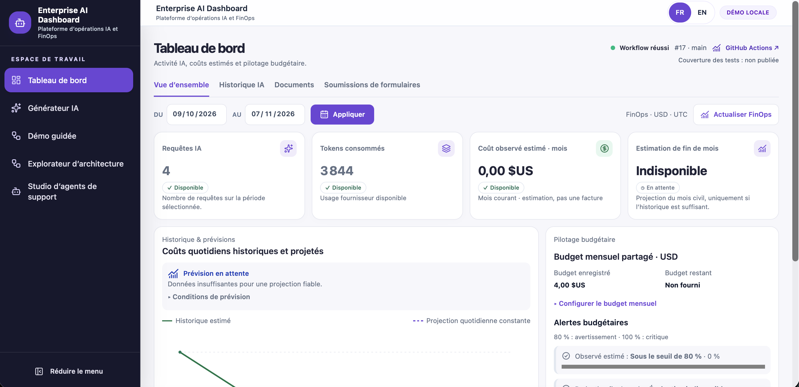
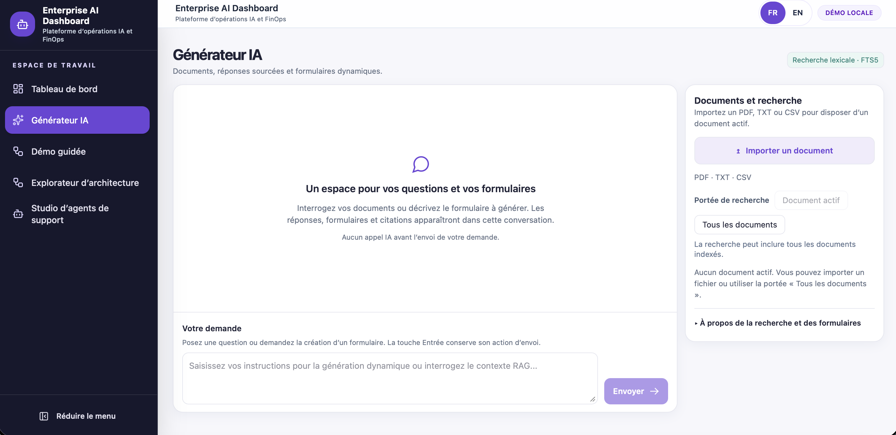
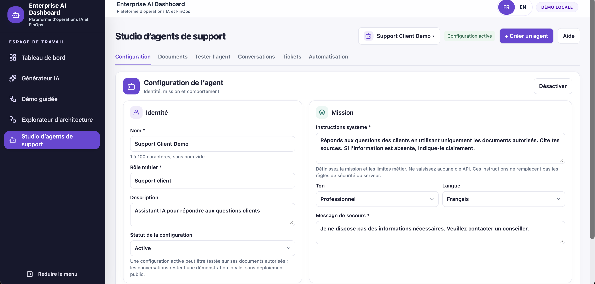

# Enterprise AI Dashboard & Support Agent Studio

**Full-Stack Angular 19 / TypeScript and Node.js / Express portfolio featuring Generative AI, LLM integration, Lexical RAG, document-assisted support AI Agents and AI FinOps.**

Designed and developed by **Rabiaa NOUIRA**.

English · [Français](README.fr.md)

[Explore the showcase](https://angular-ai-dashboard.pages.dev) · [Interface gallery](https://angular-ai-dashboard.pages.dev/features) · [Guided demo](https://angular-ai-dashboard.pages.dev/guided-demo) · [Architecture explorer](https://angular-ai-dashboard.pages.dev/architecture)

> The public showcase is an interactive static presentation with real screenshots of the local application. It performs no AI inference and provides no access to the operational backend or local data.

## What the project demonstrates

This portfolio project connects document retrieval, AI-assisted interfaces, customer support operations and estimated AI cost tracking in one bilingual application. The operational application runs locally; the public showcase lets visitors explore its capabilities without executing business actions.

| Capability | Implemented behaviour |
| --- | --- |
| AI Generator | PDF/TXT/CSV import, document-scoped questions, inspectable sources, execution details and AI-generated forms with explicit submission. |
| Support Agent Studio | Agent configuration, authorised documents, independent testing and persistent conversations with bounded context. |
| Support Ticket Management | Confirmed ticket creation, deterministic classification, search, filters, optimistic updates and an audit trail. |
| Human Handoff | Local handoff requests, declared assignments, notes and resolution, independent of ticket status. |
| Workflow Automation | Durable event receipts, explicit run preparation, manual recovery and a local simulator. |
| AI FinOps Dashboard | Recorded usage, estimated costs, pricing coverage, conditional forecasts, a saved shared budget and scenario simulation. |
| Product discovery | Interactive guided demo and architecture explorer; French/English interfaces. |

## Real application screenshots

These are real screenshots of the local application using demonstration content, not generated mockups. Images capture a particular state; they are not live metrics or evidence of production deployment. Click an image to view it at full size.

### FinOps Dashboard

[](client/showcase-assets/screenshots/dashboard-overview.png)

Usage and cost estimates remain distinct from billing. This capture shows an unavailable forecast because the required history is insufficient.

### AI Generator

[](client/showcase-assets/screenshots/ai-generator.png)

The empty state shows the document and question workflow before any explicit AI request.

### Support Agent Studio

[](client/showcase-assets/screenshots/studio-configuration.png)

A demonstration agent configuration. An active configuration is not a publicly deployed agent.

## Architecture

| Layer | Technology and role |
| --- | --- |
| Interface | Angular 19, TypeScript, standalone components, Signals, Reactive Forms, SCSS/Tailwind CSS v4 and Transloco. |
| Backend | Node.js / Express BFF; validation, document processing and explicit Groq requests. |
| Persistence | SQLite with additive migrations, conversations, tickets, handoffs and workflow audit records. |
| Document retrieval | Lexical RAG using SQLite FTS5 matching and BM25 ranking over extracted document chunks. |
| AI provider | LLM integration through the Groq API, called server-side following explicit user actions. |
| Public presentation | Separate Angular showcase build with informational routes and no operational business API client. |

Document flow: **PDF/TXT/CSV → extracted text → chunks → FTS5/BM25 retrieval → context → explicit Groq request → answer and references**.

Retrieval policies differ: the Generator can answer without document support when no relevant passage is found; the Studio applies stricter document-scoped abstention. Citations identify passages, not a guarantee of factual correctness.

Bounded agentic workflows: an internal LLM tool-calling loop uses two read-only dashboard tools, strict argument validation and execution limits. This internal engine is not connected to the Angular interface. It is separate from local support workflow automation, whose execution is simulated.

## Freelance capabilities illustrated

- Building and modernising Angular business interfaces, responsive layouts and bilingual user journeys.
- Integrating document-assisted AI with server-side API access and inspectable sources.
- Prompt Engineering: system instructions, retrieved-context assembly, citation rules and document-scoped abstention policies.
- Implementing persistent support workflows, confirmations, concurrency controls and audit trails.
- Developing usage dashboards, cost estimation and automated regression checks.

These are capabilities demonstrated by this project, not claims of client engagements, commercial results or production certifications.

## Run locally

Use Node.js 24 to match the repository CI. From the repository root:

```bash
npm ci
(cd client && npm ci --legacy-peer-deps)
(cd server && npm ci)
```

For the static showcase only, no backend or Groq key is needed:

```bash
cd client
npm run start:showcase
```

Open <http://127.0.0.1:4300/>. Public presentation routes are `/`, `/features`, `/guided-demo` and `/architecture`.

For the operational application, create a local, untracked `server/.env`:

```dotenv
GROQ_API_KEY=<your-local-key>
DASHBOARD_TELEMETRY_LOCAL_ONLY=true
HOST=127.0.0.1
PORT=3000
```

Start `npm start` from `server` and from `client` in separate terminals. Open <http://localhost:4200/dashboard>. Backend startup creates/opens the local SQLite database and automatically applies pending migrations; back up an existing database before starting an updated version.

Configure `GROQ_MODEL_PRICING` using verified model prices as described in [FinOps configuration](docs/FINOPS.md#configuration). Missing prices remain unavailable; they are not substituted with zero.

## Validation

```bash
(cd client && npm run check:i18n)
(cd client && npm test -- --runInBand)
(cd client && npm run build)
(cd client && npm run build:showcase)
(cd server && npm test)
git diff --check
```

Latest local frontend verification, 8 November 2026: **256 tests across 30 suites**, **1,269 matching translation keys**, and successful business/showcase production builds. The full suite passed under Node 24.20.0 with cache disabled and a 4 GB heap limit after an earlier native V8 crash. These are local verification results, not production certification or comprehensive responsive/accessibility certification. No tests were rerun for this README preparation.

## Scope and limitations

- Local demonstration application, without multi-user authentication or tenant isolation. Do not expose the operational backend publicly; CORS is not authentication.
- Local SQLite content is stored in clear text. Do not enter secrets or private customer data.
- Lexical retrieval only: no embeddings or vector RAG.
- Human Handoff is local and declarative; no external operator is contacted. Handoff and ticket statuses are independent.
- Workflow execution is simulated locally: no operational n8n transport, webhook, refund or outbound email.
- Agent activation saves local configuration; it does not deploy an agent.
- Costs are estimates based on configured pricing and recorded `/api/chat` traces, not complete provider billing. Forecasts require sufficient data and coverage.
- Generator conversation state is component-local; Studio conversations are persisted separately.

## Technical documentation

- [Architecture](docs/ARCHITECTURE.md)
- [FinOps](docs/FINOPS.md)
- [Observability](docs/OBSERVABILITY.md)
- [Support Agent Studio](docs/PHASE5_SUPPORT_AGENT.md)
- [Support Ticket Management](docs/PHASE5D_TICKETS.md)
- [Human Handoff](docs/PHASE5D_ESCALATIONS.md)
- [Local Workflow Engine](docs/WORKFLOW_LOCAL_ENGINE.md)
- [Workflow Automation UI](docs/WORKFLOW_AUTOMATION_UI.md)
- [Internationalisation](docs/I18N.md)

The documentation includes dated development history. Historical test counts and local database migration states should not be read as current production guarantees.

<!-- Retained anchors for existing documentation links. -->
<a id="support-agent-studio--phases-5a--5b--5c--5d-1"></a>
<a id="2-finops--prévision-des-dépenses--phase-4"></a>

## Author and licence

**Rabiaa NOUIRA** — Full-stack Angular / Node.js development and document-assisted AI integration.

© 2026 Rabiaa NOUIRA. All rights reserved.
