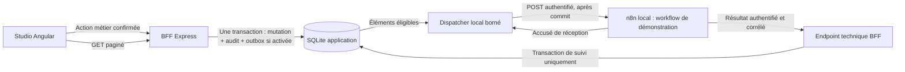

# Workflow Automation — conception de l’intégration n8n

**Statut : fondations locales et API/UI implémentées, recette fonctionnelle locale validée par le propriétaire ; transport n8n et callbacks externes non implémentés.**

La section 14 fixe les décisions exécutables du moteur local et prévaut sur les
propositions de transport des sections précédentes. Les sections de conception
réseau décrivent une cible future, pas des fonctionnalités livrées ; les endpoints
n8n restent futurs. La section 15 décrit l’extension de gestion locale.

## 1. Périmètre et constat avant les fondations locales

Enterprise AI Dashboard, branche `feat/phase-5-support-agent`, HEAD observé
`c3b0a86041a9ab2e28b445ae41adf45728890f71`. Les travaux Human Handoff et de
terminologie sont présents mais non committés. Ce cadrage ne les modifie pas.
Au moment de ce cadrage initial, 007 restait à appliquer. À la clôture documentaire
du 5 novembre 2026, 007 et 008 sont déjà enregistrées dans la base locale préparée ;
le moteur local, son API/UI et Human Handoff ont été implémentés et validés en recette
fonctionnelle Safari par le propriétaire. Le transport n8n reste une proposition
non implémentée. Voir l’[état de clôture local du Studio](PHASE5_SUPPORT_AGENT.md#cloture-locale-human-handoff-workflow).

Dernière validation communiquée avant ce cadrage : 196 tests Angular / 26 suites,
138 tests backend, build production réussi, 933 clés FR/EN. Ces résultats ne sont
pas une validation d’une intégration n8n, qui n’existe pas encore.

Sources du constat dans le dépôt :

- [`support-tickets.js`](../server/support-tickets.js) et
  [`006_support_tickets.sql`](../server/migrations/006_support_tickets.sql) :
  créations idempotentes, versions optimistes et audit transactionnel ; retraits
  des liens conversation/message par triggers.
- [`support-escalations.js`](../server/support-escalations.js) et
  [`007_support_escalations.sql`](../server/migrations/007_support_escalations.sql) :
  demandes, affectations, notes, résolution/annulation, clés d’idempotence et audit
  séparé. Les numéros de migration sont des versions techniques à conserver.
- [`local-demo-security.js`](../server/local-demo-security.js),
  [`dashboard-routes.js`](../server/dashboard-routes.js) et
  [`cors-policy.js`](../server/cors-policy.js) : BFF loopback, garde de démonstration
  locale et origines frontend bornées. Ces contrôles ne constituent pas une identité
  utilisateur ni une autorisation multi-tenant.
- [`agent-tickets.component.ts`](../client/src/app/components/agent-workspace/agent-tickets.component.ts)
  et [`agent-escalations.component.ts`](../client/src/app/components/agent-workspace/agent-escalations.component.ts) :
  confirmations, brouillons, erreurs et formulaires bilingues à réutiliser.

Les journaux existants ne constituent pas un bus d’événements : pas d’outbox, de
worker de livraison, de configuration n8n ou de suivi de livraison dans ce code.
Les événements contiennent parfois du texte métier ; leur export brut est exclu.

## 2. Décision proposée : outbox locale, livraison découplée

Le BFF reste propriétaire des données et des décisions métier. n8n reçoit uniquement
une projection minimale d’un événement confirmé ; il ne lit jamais directement le
fichier SQLite de l’application et ne reçoit aucune permission de remboursement.

Deux activations explicites sont nécessaires : autorisation serveur du dispatcher,
puis activation confirmée d’une liaison agent/événement/workflow. Par défaut :
**désactivé**, aucun POST, aucun test réseau à l’ouverture d’un écran, aucun démarrage
ou installation automatique de n8n. La présence d’une variable ou d’un secret ne
vaut pas activation d’une liaison.

L’outbox est insérée **dans la transaction métier**, après production de l’événement
et avant commit. La capture durable de l’éligibilité partage la transaction métier ; la création
d’un run est différée si la capacité est atteinte. Désactivation et saturation ne
font jamais échouer le transfert. Une impossibilité physique de commit SQLite
(disque plein, corruption) reste une erreur de stockage, pas une saturation logique. Une panne réseau n’a lieu qu’après
commit et ne bloque ni n’annule la mutation. Les appels HTTP et attentes réseau sont
interdits dans une transaction SQLite.

Un seul dispatcher dans le BFF suffit au volume actuel ; requêtes de sélection
indexées, lots bornés et aucune dépendance Redis au départ. L’architecture permet
ensuite un worker séparé utilisant le même protocole de lease, si nécessaire.

## 3. Événements métier candidats

Les noms publics proposés sont indépendants des noms de phases et des tables.

| Source réelle | Type existant | Événement d’intégration proposé | Première livraison |
| --- | --- | --- | --- |
| Audit ticket | `created` | `ticket.created` | Option ultérieure |
| Audit ticket | `classified` | `ticket.classified` | Exclu par défaut pour éviter un double déclenchement à la création |
| Audit ticket | `status_changed` | `ticket.status_changed` | Option ultérieure, filtre old/new validé |
| Audit ticket | `priority_changed` | `ticket.priority_changed` | Option ultérieure |
| Audit ticket | `category_changed` / `classification_changed` | `ticket.category_changed` / `ticket.classification_changed` | Option ultérieure |
| Audit transfert | `requested` | `handoff.requested` | Seul déclencheur initial recommandé |
| Audit transfert | `assigned` | `handoff.assigned` | Option ultérieure |
| Audit transfert | `resolved` / `cancelled` | `handoff.resolved` / `handoff.cancelled` | Option ultérieure |
| Audit transfert | `noted` | `handoff.note_added` | Désactivé ; aucun texte de note exporté par défaut |
| Triggers ticket | `source_unlinked` / `conversation_unlinked` | Aucun initialement | Maintenance de références, pas une action d’intégration |

Un retry idempotent ou une modification sans changement ne produit aucun nouvel
événement d’intégration. `created` et `classified` ne doivent pas déclencher le même
workflow à la création par simple activation globale.

Les IDs croissants des deux journaux sont distincts : référence source composée
`{sourceKind,eventId}`, jamais un entier seul. L’outbox fournit en outre un UUID
stable de livraison. Les événements générés par triggers ne sont pas capturés dans
le premier incrément ; une couverture ultérieure devra être conçue explicitement.

**Pas de rattrapage automatique de l’historique.** Une activation prend effet pour
les nouvelles transactions seulement. Le contrôle de configuration et la création
outbox utilisent le même instant transactionnel ; une réactivation ne ressuscite
pas les événements anciens. Un replay historique serait une action séparée,
avec aperçu, limites, confirmation et nouveau cadrage.

## 4. Contrat de webhook et résultat

Projection proposée, versionnée `schemaVersion: 1` : identifiant de livraison,
référence source, type, date UTC, agentId, ticketId, handoffId si pertinent, version
métier à cet instant et enums strictement nécessaires (motif/statut/catégorie).
Pas de conversation, document, extrait RAG, titre, description, nom de client,
opérateur déclaré, note de résolution ou secret. Pour le scénario fictif seulement,
un marqueur de test `NS-2026-1042` peut être ajouté par un fixture de démonstration
confirmé ; il ne justifie pas l’export général des références de commande.

Le payload est un **instantané d’événement**, pas l’état actuel garanti du ticket.
Il est borné à 8 KiB, construit côté serveur, persisté pour des retries identiques.
Les champs inconnus sont refusés par le contrat n8n et le BFF. Aucun template libre,
expression n8n ou URL fourni par un utilisateur dans les données métier.

n8n distingue les URL de test et d’exploitation, propose notamment l’authentification
par en-tête et plusieurs modes de réponse. Retenir une URL d’exploitation configurée
explicitement, sans dépendre du bouton d’écoute temporaire de l’éditeur. Un accusé
rapide confirme seulement la réception ; le résultat métier doit être séparé.
[Documentation officielle Webhook](https://docs.n8n.io/integrations/builtin/core-nodes/n8n-nodes-base.webhook/).

Contrat recommandé : réponse 202 JSON avec `deliveryId` et `accepted: true`, puis
callback final contenant `deliveryId`, `callbackId`, `executionId` n8n, résultat
`simulated_success` ou `failed`, et code borné non sensible. Une réponse 2xx quelconque
ou un texte HTML ne signifie jamais « automatisation réussie ». Le nœud
[Respond to Webhook](https://docs.n8n.io/integrations/builtin/core-nodes/n8n-nodes-base.respondtowebhook/)
permet de définir cette réponse : le workflow de démonstration doit être testé
contre ce contrat, pas seulement contre son code HTTP.

Un callback peut arriver avant que le dispatcher ait enregistré le 202. Son écriture
terminale fait autorité ; l’accusé tardif ne doit pas faire régresser l’état.
L’identifiant n8n n’est connu qu’après réception ; ne pas en inventer avant livraison.
Un succès indique ici une **simulation technique**, jamais un remboursement exécuté.

## 5. Configuration, secrets et frontières de sécurité

- Angular appelle uniquement le BFF ; aucun secret webhook, token n8n ou accès direct
  au gestionnaire d’identifiants n’est exposé au navigateur.
- Un registre de cibles contrôlé côté serveur associe `targetKey` à une URL et une
  référence de credential. SQLite conserve seulement ces références non secrètes,
  l’événement choisi et les métadonnées de configuration.
- Secret sortant et secret de callback distincts, fournis par un gestionnaire local
  de secrets ou fichiers privés hors dépôt ; variables d’environnement possibles
  pour la démo si leur gestion et permissions sont explicites. Aucun secret en clair
  dans SQLite, URL, query string, workflow exporté, log ou fichier de conception.
- Utiliser les credentials n8n pour l’en-tête partagé ; n8n chiffre ses credentials
  au repos avec une clé dédiée. La clé et ses sauvegardes restent hors des bases et
  du dépôt ; sa rotation doit être planifiée, pas improvisée.
  [Documentation du chiffrement n8n](https://docs.n8n.io/hosting/configuration/configuration-examples/encryption-key/).
- Attention aux en-têtes d’authentification présents dans les entrées Webhook n8n :
  le chiffrement des credentials ne protège pas une copie du secret dans un payload
  d’exécution. Pour la démonstration, désactiver la sauvegarde des données d’exécution
  réussies, en erreur, manuelles et intermédiaires ; ne pas épingler ces entrées ni
  journaliser les en-têtes. Valider sur une instance de test avec un marqueur secret
  jetable que la base n8n, ses exports et logs ne le conservent pas en clair avant
  activation. Une simple étape de nettoyage après le Webhook n’est pas une preuve
  que les entrées originales n’ont pas été persistées.
- Une URL cachée ne vaut pas authentification. Pour le premier déploiement local :
  Header Auth côté n8n, authentification machine dédiée côté callback, comparaison
  en temps constant des secrets, erreurs génériques et rotation coordonnée.
- Réseau initial : n8n et BFF sur le même hôte, interfaces loopback. Pas de tunnel,
  pas de publication de ports sur toutes les interfaces. Docker ou n8n Cloud ne sont
  pas supposés joignables via `localhost` : leur topologie nécessite un cadrage
  distinct, sans élargir le bind du BFF pour contourner le problème.
- Protection SSRF : pas d’URL saisie librement dans Angular. Cibles fixes du registre,
  méthode POST, hôte/IP/port/chemin autorisés ; aucun userinfo, fragment, secret de
  query ou redirection HTTP. En local, préférer IP loopback littérale approuvée.
  Une cible externe ultérieure exige HTTPS, validation DNS/IP à la connexion et
  protection contre rebinding, métadonnées cloud et réseaux privés non autorisés.
- Callback machine : portée sur la livraison et sa cible attendue, secret propre à
  la cible, taille bornée, délai de validité borné et déduplication durable.
  Ne pas réutiliser le seul garde loopback comme authentification machine.
- Les API de configuration gardent le garde local et le CORS existants. CORS ne
  protège pas les communications serveur-à-serveur. Le callback n’est pas une API
  navigateur et ne reçoit pas d’élargissement CORS générique.
- Pas d’accès SQLite partagé, de shell, de lecture libre de fichiers, d’API n8n
  d’administration ou de credentials de paiement/messagerie dans la démonstration.

## 6. Modèle minimal proposé — migration future uniquement

Une future migration additive, après validation et préparation de la base, ajouterait
les trois tables suivantes. Aucun SQL n’est créé/exécuté dans cette tâche ; les
migrations existantes restent intactes. La numérotation sera choisie au moment de
l’implémentation selon l’état réel du dépôt.

| Table proposée | Champs et contraintes principales |
| --- | --- |
| `workflow_bindings` | UUID, agentId FK, nom fonctionnel, événement autorisé, `target_key`, `credential_ref` non secret, mode `local_simulation`, enabled=false, version positive, dates d’activation/modification ; unicité agent/événement/cible |
| `workflow_runs` (outbox + suivi) | UUID deliveryId, bindingId/version et cible figés, sourceKind/eventId, agentId/ticketId/handoffId, schemaVersion, payload minimal/hash, état, tentative courante, nextAttemptAt, leaseOwner/leaseUntil/fencingVersion, executionId nullable, dates ; unicité bindingId/sourceKind/eventId |
| `workflow_run_events` | ID croissant, runId FK, type `queued/attempt_started/accepted/retry_scheduled/completed/failed/paused/unknown`, numéro de tentative, date UTC, durée mesurée nullable, statut HTTP nullable, code sûr, callbackId/hash si présent ; unicité runId/callbackId pour les callbacks et runId/tentative/type pour les événements de tentative |

Les événements de suivi ne stockent ni corps HTTP brut, ni en-têtes, ni stack trace
fournisseur. Un type de résultat simulé validé suffit. Le hash de payload n’est pas
un chiffrement et ne justifie pas d’y stocker des données personnelles.

Références sources issues de tables différentes : validation applicative obligatoire,
pas de FK polymorphique prétendument disponible dans SQLite. Les IDs métier et leurs
appartenances sont vérifiés avant création. Les changements de destination créent une
nouvelle révision : ne jamais détourner une livraison déjà en file vers une autre URL.

Suppression d’agent/ticket : annuler les livraisons non commencées dans la transaction
de suppression, puis appliquer une politique FK explicite. Recommandation initiale :
conserver les runs minimisés avec liens métier nullable et tombstone, éviter toute
cascade silencieuse de l’historique technique. Une réponse en vol ne peut être
« désenvoyée » ; elle ne recrée jamais une ressource supprimée. Cette rétention et
la purge confirmée doivent être documentées avant création du schéma.

Les événements techniques finaux sont append-only via API. Une politique initiale
proposée, à valider, conserve 30 jours de runs terminaux ; elle ne purge jamais un run
actif ou incertain. Pas de purge ni VACUUM automatique de la base métier dans la démo.
La rétention n8n est configurée séparément pour limiter les payloads d’exécution.
[Gestion des données d’exécution n8n](https://docs.n8n.io/hosting/scaling/execution-data/).

## 7. Livraison, concurrence, retries et idempotence

Valeurs **proposées**, non mesurées, à confirmer par tests :

| Paramètre | Proposition initiale |
| --- | --- |
| Concurrence | 1 livraison, lots de sélection de 10 |
| Timeout de livraison | 5 secondes, connexion/lecture incluses |
| Lease | 30 secondes, acquisition conditionnelle transactionnelle |
| Tentatives | 3 au total ; attentes 5 puis 30 secondes avec jitter borné |
| Attente du callback | 2 minutes après acceptation ; au-delà `unknown` |
| Pagination | 25 par défaut, 50 max ; filtres allowlist |

États proposés : `queued → delivering → accepted → completed` ; échec transitoire
avant acceptation → `retry_wait → delivering` ; erreur permanente ou tentatives
épuisées sans réception incertaine → `failed` ; réception/fin ambiguë → `unknown`.
Un run `paused` n’est pas expédié tant que sa liaison et l’autorisation serveur ne
sont pas actives. Réactivation ne rejoue rien silencieusement.

- Acquisition d’un run par compare-and-swap ; commit avant HTTP. L’expiration de
  lease n’est pas la preuve que l’appel précédent n’a pas eu lieu. Le fencing empêche
  un ancien worker d’écraser l’état d’un nouveau ; aucun verrou SQLite pendant HTTP.
- Idempotency-Key sortante = deliveryId stable sur toutes les tentatives ; payload
  identique. La clé métier initiale des tickets/transferts reste indépendante.
- Retry automatique borné pour refus de connexion, 408, 429 et 5xx dans le mode local
  sans effet externe. Respecter `Retry-After` valide dans une borne configurée.
  Un timeout ou 5xx peut survenir après traitement : réception potentiellement ambiguë.
- 400/401/403/404/422 : arrêt, erreur de contrat/configuration ; aucune boucle
  infinie. Un 409 n’est reconnu comme doublon accepté que si le contrat authentifié
  renvoie la même deliveryId ; sinon échec à examiner. Redirections refusées.
- Après 202 reconnu : ne plus rejouer automatiquement le webhook. Sans callback,
  afficher `unknown` et proposer vérification manuelle, pas « échec métier certain ».
- Callback et événement final sont écrits dans une transaction ; même callbackId et
  même hash → réponse identique ; même ID/payload différent → 409 ; résultat terminal
  contradictoire → rejet et diagnostic, jamais écrasement silencieux. Une réponse
  terminale valide peut clore un état `unknown` dans la fenêtre autorisée.
- Retry manuel : confirmation, clé d’idempotence de l’action de reprise, contrôle de
  version et conservation de deliveryId/payload. Un état incertain exige un avertissement
  sur les doublons ; pour une action externe future, reprise bloquée sans réconciliation.
- Désactivation : stoppe les nouvelles mises en file et met les non-expédiés en pause.
  Recontrôler le flag juste avant envoi. Un appel déjà parti ne peut pas être annulé
  avec garantie ; le résultat tardif est audité. Ne pas afficher « annulé » comme une
  preuve qu’aucun système distant n’a reçu l’événement.

**Garantie retenue : événements conservés durablement, tentatives bornées, doublons
possibles, aucune perte silencieuse ; aucune garantie de réception distante.** Un webhook n8n
ne fournit pas à lui seul la déduplication d’effets. Le scénario initial ne produit
aucun effet externe : les exécutions dupliquées sont tolérées et leur callback est
dédupliqué dans le BFF. Avant toute extension à des effets réels : registre de
réception durable/claim atomique côté workflow et idempotence de la destination,
ou réconciliation explicite. Ne pas générer une nouvelle clé à chaque exécution n8n.

n8n dispose de Retry On Fail et de workflows d’erreur. Ils ne remplacent pas la
politique de transport ci-dessus ; éviter de multiplier les retries BFF/nœud/workflow.
L’Error Trigger peut servir au callback d’échec sûr, sans e-mail ni Slack. L’ID n8n
peut être indisponible lorsque l’échec se produit avant création d’une exécution.
[Retries n8n](https://docs.n8n.io/integrations/builtin/handle-rate-limits/),
[gestion d’erreur n8n](https://docs.n8n.io/flow-logic/error-handling/).

## 8. Endpoints proposés — tous absents aujourd’hui

| Méthode et chemin | Usage et protection |
| --- | --- |
| GET `/api/agents/:id/workflow-bindings` | Configurations non secrètes, état et capacité d’envoi |
| POST `/api/agents/:id/workflow-bindings` | Créer une liaison désactivée, cible du registre seulement |
| PATCH `/api/agents/:id/workflow-bindings/:bindingId` | Version + modification/activation/désactivation confirmée et idempotente |
| POST `/api/agents/:id/workflow-bindings/:bindingId/test` | Événement synthétique explicite, local seulement, pas une vraie mutation métier |
| GET `/api/agents/:id/workflow-runs` | Liste paginée et filtrée, avec ticketId facultatif contrôlé |
| GET `/api/agents/:id/workflow-runs/:runId` | Résumé sûr et historique paginé des tentatives/décisions |
| POST `/api/agents/:id/workflow-runs/:runId/retry` | Reprise confirmée, version, clé d’action et règles d’incertitude |
| POST `/api/workflow-callbacks/:targetKey` | Machine uniquement ; authentification dédiée, portée deliveryId, déduplication |

Endpoints UI : garde local actuel, validation stricte, associations agent/liaison/run,
JSON borné, champs inconnus refusés. Aucun endpoint de saisie/lecture d’un secret,
aucun DELETE de masse, aucun proxy HTTP générique. Le callback ne reçoit pas une URL
de destination depuis le client. Les erreurs restent sûres et traduisibles FR/EN.
Des permissions multi-utilisateur seraient un projet séparé avant ouverture réseau.

## 9. Écrans et traçabilité

Réutiliser Support Agent Studio et ses cinq espaces. Pas de nouvelle route principale
au départ : section compacte « Automatisation des workflows / Workflow Automation »
dans la configuration de l’agent, puis sous-panneau de suivi sur le ticket/transfert.

Configuration : événement, workflow nommé, cible non secrète, mode Simulation locale,
état désactivé/actif, explication des données transmises, confirmation d’activation et
bouton « Tester avec des données fictives » explicitement actionné. Pas de connexion
réseau lors d’un GET, de la navigation ou d’une bascule FR/EN.

Suivi : runId, événement source, livraison en attente/reçue/résultat simulé/incertain,
tentatives, horodatages, statut HTTP et durée mesurée. ID n8n nullable ; lien vers
l’exécution construit uniquement depuis la base n8n autorisée et l’ID validé, jamais
une URL arbitraire fournie par le callback. Pas de token dans un lien.

Distinguer temps d’attente, latence HTTP locale et durée de workflow quand connue ;
ne pas afficher une donnée absente comme zéro. Aucun token/coût IA inventé, aucun
ajout aux agrégats FinOps par cette intégration sans inférence. La trace de livraison
n’est pas un nouvel Execution Tracing global ou un audit de paiement.

Préserver brouillons, sélections, confirmations et historique au changement de langue ;
labels accessibles, focus visible, états loading/error/empty/disabled/unavailable et
lecture mobile. Les logs contiennent uniquement identifiants techniques minimisés,
codes, compteurs et durées ; les corps de réponse n8n ne sont pas affichés en HTML.

## 10. NovaShop : démonstration sans effet externe

1. Après validation de cette architecture et préparation des migrations, utiliser un
   ticket fictif existant « Produit défectueux — Casque Bluetooth — NS-2026-1042 ».
2. Préparer manuellement n8n local : Webhook authentifié → validation de schéma →
   202 contractuel → construction d’un résultat synthétique → callback BFF.
   Aucun nœud de paiement, messagerie, IA, shell ou service externe.
3. Créer une liaison désactivée `handoff.requested`, puis confirmer son activation
   et le mode Simulation locale ; vérifier cible et résumé du payload minimal.
4. Demander et confirmer un transfert pour validation de remboursement. Le ticket
   et son audit sont commités avec l’outbox ; la livraison apparaît dans son suivi.
5. Vérifier réception puis `simulated_success`, corrélation n8n et persistance après
   rechargement. Le transfert reste `requested` jusqu’à décision humaine explicite ;
   aucun statut, remboursement ou e-mail ne change automatiquement.
6. Arrêter volontairement n8n pour un autre événement fictif confirmé : observer les
   retries bornés. Simuler une réponse perdue et un callback doublé sur un environnement
   de test ; une seule finalisation locale, incertitude affichée si nécessaire.
7. Désactiver la liaison et confirmer l’absence de nouvel envoi. Vérifier FR/EN,
   clavier et responsive dans Safari ; ne pas rejouer de données locales réelles.

Ce scénario est une procédure future ; il n’est pas exécuté par le présent cadrage.

## 11. Alternatives et arbitrages

| Alternative | Arbitrage |
| --- | --- |
| Appeler n8n directement depuis Angular | Rejeté : secrets, navigation/retry et couplage navigateur |
| Appeler n8n dans le POST métier / transaction | Rejeté : latence, verrou et commit distant non atomique |
| Scruter les journaux existants sans outbox | Moins de code initial, mais checkpoints/replays et activation rétroactive délicats ; non retenu |
| Réponse finale synchrone du webhook | Plus simple pour un test très court ; alternative possible si le callback est différé, avec timeout et état ambigu explicites |
| Outbox + dispatcher + callback | Recommandé : séparation de panne, reprise et traçabilité, au prix de nouveaux états et tests |
| Broker/Redis/queue mode n8n | Reporté : coûts d’exploitation inutiles au volume local, migration possible plus tard |
| n8n Cloud / callback public | Reporté : incompatible avec le BFF loopback non authentifié actuel |
| Partager la base SQLite avec n8n | Rejeté : permissions, contournement de l’API et couplage au schéma |

## 12. Plan incrémental et critères d’acceptation

1. **Revue et prérequis** : valider payload, cible locale, secrets, rétention, sémantique
   des états et politique d’activation ; finaliser/revoir les travaux locaux existants,
   préparer la sauvegarde et la migration Human Handoff séparément. Aucun commit
   automatique, aucune application implicite à la base locale.
2. **Outbox sans réseau** : migration additive sur base de test ; insertion atomique
   pour `handoff.requested` uniquement ; dispatcher désactivé. Tester préservation
   de toutes les tables existantes, FK, rollback, replay métier, activation/cutoff.
3. **Transport avec faux serveur local** : tester timeout, 202/non-JSON, erreurs
   permanentes/transitoires, Retry-After, lease/fencing, crash après envoi, reprise,
   doublons, callback précoce/tardif/forgé, résultat contradictoire et désactivation.
4. **Démo n8n locale opt-in** : version n8n choisie et figée, workflow contrôlé,
   Header Auth et callback séparé ; valider les capabilities de cette version. Aucun
   secret dans export, SQLite, navigateur, sauvegarde de configuration ou logs.
5. **Interface FR/EN et suivi** : tests de confirmations, brouillons, erreurs,
   incertitudes, données indisponibles et absence de POST sur navigation/langue.
   Tests Angular/backend complets, build, catalogues, budgets, cinq routes lazy,
   `git diff --check` et revue Safari avant publication.
6. **Élargissement ultérieur** : autres événements seulement après validation.
   Actions externes, authentification et effets réels nécessitent un cadrage et une
   autorisation spécifiques ; le mode initial ne comporte pas de bouton pour les activer.

Critères bloquants : zéro trafic avec configuration par défaut ; mutation/audit/outbox
atomiques ; aucune perte silencieuse après crash ; clés stables ; limites de retries
respectées ; état `unknown` honnête ; aucun secret ou texte client inutile exporté ;
aucun état métier changé par un callback ; tests de séparation agent/run réussis.
Un 202 seul, un build réussi ou un scénario nominal ne suffisent pas à valider ces critères.

## 13. Risques et décisions à valider

- **Doublons distants** : impossibilité d’exactly-once par HTTP seul ; pas d’effets réels
  avant déduplication côté destination et stratégie d’incertitude validées.
- **Secret/SSRF** : registre serveur strict, permissions des secrets et URLs sûres
  sont obligatoires ; CORS et nom de workflow ne sont pas des garanties.
- **Confidentialité n8n** : limiter le payload et les données d’exécution conservées ;
  vérifier exports, données épinglées, journaux et sauvegardes de l’instance.
- **SQLite/volume** : limites de file, indexes et backpressure à définir lors des tests ;
  proposer un plafond de 1 000 runs non terminaux par agent, report durable de
  l’automatisation à saturation, sans refus du transfert humain.
- **Dérive de workflow** : une activation approuve une version revue du workflow.
  Modification du workflow/cible exige revue et réactivation ; un nom identique ne
  prouve pas que le workflow n’a pas acquis une action externe.
- **Absence d’identité** : acteur local déclaratif, démo sur machine contrôlée ; aucune
  prétention d’approbation réglementaire ou d’autorisation multi-utilisateur.
- **État local à la clôture** : Human Handoff et Workflow Automation sont non committés
  mais leur recette locale est validée. La base a les huit migrations, dont 007/008 ;
  aucun transport n8n n’a été implémenté ou testé. Sa démonstration réseau reste future.

Décisions demandées : retenir l’outbox et le callback, limiter le premier événement
à `handoff.requested`, confirmer le mode local simulé et le payload minimal, puis
valider les bornes et la rétention proposées. **Ne pas commencer l’implémentation
avant cet accord.** Aucune commande de démarrage n8n, aucun appel de webhook réel,
aucune migration, aucun commit ou push dans ce travail documentaire.

## 14. Décisions finales — Local Engine Foundation

### Frontière et saturation

Le moteur local n’importe aucun client réseau, n’installe aucun timer et n’est pas
lancé au démarrage du backend. Aucun endpoint réseau de workflow ou callback n’est
ajouté. Seul `handoff.requested` est éligible. Une liaison activée capture chaque nouvel
événement requested dans un reçu durable, **dans la transaction d’audit du transfert**,
par trigger SQLite. Le reçu contient uniquement IDs, version et enum du motif, jamais
notes, opérateur, documents ou secret. Un retry métier ne crée pas de second reçu.

Les reçus et les runs sont séparés : la capacité limite les runs non terminaux, pas
la capture. À saturation, le reçu reste `deferred` avec audit, le transfert réussit.
Désactiver une liaison exclut les nouveaux événements futurs de cette liaison ; les
reçus déjà capturés sont conservés en pause. Le commutateur dispatcher ne supprime
jamais l’éligibilité d’une liaison activée : il empêche uniquement l’exécution.
Aucun rattrapage des événements survenus avant activation d’une liaison.

Garanties : audit métier et reçu commités ensemble, reçus différés inspectables,
payload figé et dédupliqué, tentatives bornées et historique conservé. La capacité
logique ne provoque pas de refus métier. Limites : disque plein/corruption peuvent
empêcher toute transaction SQLite, aucune durabilité magique au-delà d’un commit
physiquement possible, aucun plafond dur des reçus sans politique d’archivage validée.
L’activation implique donc de surveiller le stockage ; aucune purge automatique.

### Machine exhaustive du moteur local

Toute transition non listée est refusée. `succeeded`, `failed`, `cancelled` sont
terminaux ; un `failed` peut être repris explicitement seulement s’il reste des
tentatives. `unknown` est non terminal et requiert une décision explicite.

| Objet/source | Action/condition | Destination | Invariant |
| --- | --- | --- | --- |
| Nouveau reçu | liaison activée | deferred, ou paused si dispatcher arrêté | transaction métier, unicité liaison/événement |
| Reçu deferred | capacité disponible, liaison et dispatcher actifs | materialized + run queued | transaction immédiate, un run par reçu |
| Reçu deferred | capacité atteinte | deferred | audit de saturation dédupliqué, aucune erreur métier |
| Reçu deferred | arrêt dispatcher ou liaison | paused | audit, pas de suppression |
| Reçu paused | reprise confirmée, version correcte, activation effective | deferred | jamais par simple réactivation |
| Reçu sans run | suppression du ticket/agent | cancelled | reçu et audit conservés |
| Run queued/retry_wait dû | claim explicite, activation effective | running | tentative +1, fence +1, lease et propriétaire |
| Run running | résultat success, lease et fence valides | succeeded | une finalisation atomique |
| Run running | erreur transitoire simulée, budget restant | retry_wait | échéance déterministe, pas de timer |
| Run running | erreur permanente ou budget épuisé | failed | aucune tentative supplémentaire automatique |
| Run running | réponse perdue simulée ou lease expirée | unknown | fence révoqué, pas de reprise silencieuse |
| Run running | résultat après lease expirée | refus ; récupération explicite vers unknown | aucune réussite déduite d’une réponse tardive |
| Run queued/retry_wait/running/unknown | désactivation | paused | fence révoqué si nécessaire, budget conservé |
| Run paused/unknown/failed | reprise confirmée, activation effective, tentatives restantes et capacité disponible si failed | queued | version + audit + clé de commande |
| Run non terminal, ou failed reprenable | suppression du ticket/agent | cancelled | liens techniques tombstonés, fence révoqué |
| Run terminal | résultat identique déjà accepté pour son fence | réponse initiale | pas de nouvel événement |
| Tout run | résultat contradictoire même fence | conflit | aucune modification du résultat initial |
| Tout run | résultat d’un ancien worker/fence | refus | pas d’écrasement de l’état courant |

### Crash, fencing et résultats

Au redémarrage, rien n’est lancé automatiquement. Une invocation explicite de
récupération transforme les leases running expirées en unknown, puis audite le fait.
Une lease running encore valide n’est pas volée. Le token de fencing est monotone ;
claim, arrêt, expiration et annulation invalident les anciennes écritures. Aucune
attente I/O dans SQLite. Le simulateur produit toujours un succès déterministe ;
les résultats transitoires/permanents/incertains sont injectés explicitement par les
tests des primitives, jamais obtenus depuis un service externe.

La finalisation est dédupliquée par run/fence avec hash d’un résultat enum borné.
Les résultats identiques rejouent la réponse originale ; un résultat contradictoire
est refusé. Un résultat portant un ancien fence ne peut ni terminer ni ressusciter
un run, même après reprise. Le moteur local n’accepte aucun callback réseau ; la
corrélation/signature/fraîcheur des futurs callbacks reste un prérequis du transport.

### Versions, commandes et reprise

Trois compteurs distincts : révision de liaison pour ses changements, version de run
pour les décisions concurrentes, fencing token pour l’autorité d’écriture du worker.
Un reçu conserve la révision de liaison de capture, sans migration de sa destination.
Les commandes locales de création/activation/reprise exigent requestId et, lorsque
l’objet existe, sa version attendue ainsi qu’une confirmation explicite. Leur
scope/hash/réponse est conservé dans l’audit : même clé/payload rejoue la réponse,
clé réutilisée avec un autre payload produit un conflit. Un succès rejoué ne prétend
pas être l’état actuel ; relire l’objet pour son état actuel.

Le budget initial est trois claims maximum, compteur persistant ; une reprise
manuelle ne remet pas le budget à zéro. Les délais simulés sont 5 puis 30 secondes,
sans jitter pour rendre les tests reproductibles. L’horloge est injectable, les
leases durent 30 secondes. Les commandes de tick/claim sont explicites : aucun
scheduler, HTTP, e-mail, remboursement, secret ou mode externe.

### Pause, suppression et rétention

Réactiver ne reprend aucun reçu/run paused. Une commande de reprise distincte est
nécessaire. Les nouveaux événements après réactivation peuvent être capturés, sans
rattrapage rétroactif. Les runs paused/unknown occupent la capacité : cette décision
peut accumuler un backlog de reçus mais ne bloque pas les transferts humains.

Les suppressions métier existantes restent possibles : liaisons désactivées et
orphelines lors de la suppression d’agent, reçus/runs non terminaux annulés lors de
la suppression d’un agent ou ticket. L’audit technique et les snapshots minimaux
restent conservés ; ils ne contiennent pas les textes du client. Pas de suppression
ou purge automatique des runs, reçus, commandes ou audits dans cette fondation.
Une politique de rétention/purge future devra préserver au moins les tombstones
nécessaires à la déduplication, et ne pas purger les inconnus sans réconciliation.

### Schéma et interface locale

Migration additive suivante uniquement, sans retouche de 001–007 : settings du
dispatcher, liaisons, reçus d’éligibilité, runs, audit avec déduplication des commandes
et résultats. Configuration par fonctions serveur testables, sans nouvel écran ni
endpoint d’administration dans cet incrément. Interfaces futures prévues en §8–9.
Les tests de migration précèdent toute utilisation réelle. Aucune migration locale
ni démarrage du backend/n8n n’est autorisé dans cette tâche.

### Compléments vérifiés du moteur local

Le modèle local effectif est détaillé dans [WORKFLOW_LOCAL_ENGINE](WORKFLOW_LOCAL_ENGINE.md).
La proposition de trois tables de transport en §6 est remplacée pour cette fondation
par cinq tables : settings, bindings, receipts, runs, audit. L’audit porte également
les clés/hashes/réponses de commandes, sans table de secrets ou registre réseau.

Matérialisation : 100 reçus au plus par invocation, capacité globale persistée 1–10 000
runs non terminaux (défaut 1 000). Les primitives autorisent des workers explicites
sur des runs distincts ; aucun worker parallèle ou scheduler n’est démarré par le module.
Le token ne garantit pas une identité, uniquement l’ordre de validité des écritures.
Un failed ne peut être remis en queue si cela dépasserait la capacité. Les commandes
refusées renvoient un code sûr sans changer l’audit des décisions acceptées ; la
fondation n’ajoute ni journal de sécurité ni endpoint externe de résultats tardifs.

## 15. Extension de gestion locale

L’[API et interface locale](WORKFLOW_AUTOMATION_UI.md) réutilise les fondations ci-dessus. Les endpoints du transport n8n en section 8 restent proposés et non implémentés ; l’extension expose uniquement les commandes du simulateur sous `/api/agents/:id/workflow-automation`. Elle n’autorise aucun webhook ou callback externe.
